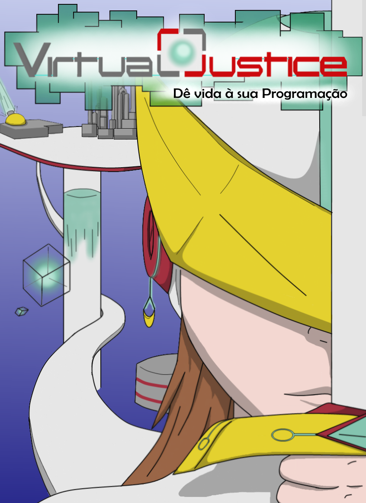
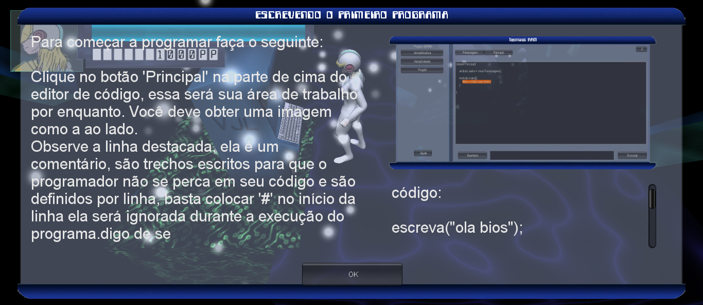
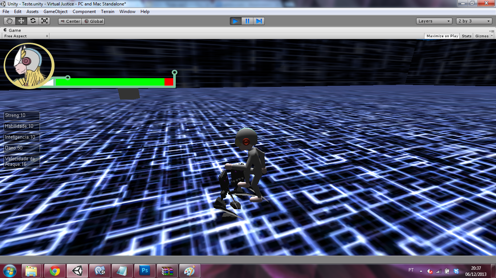
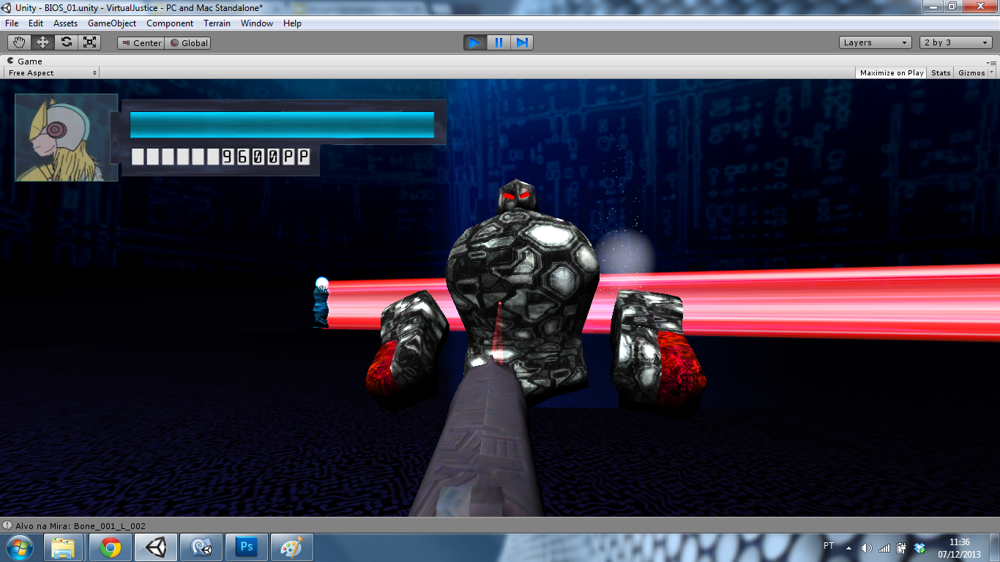
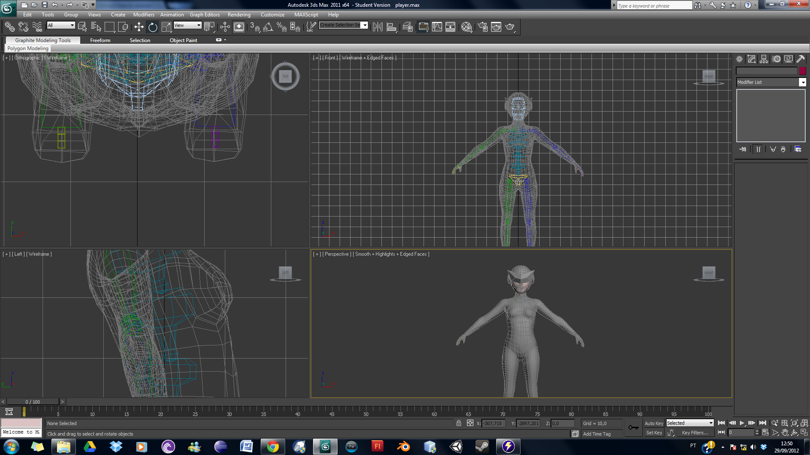

# Virtual Justice

  

  <strong>Bring your Programming to Life</strong> 
  A serious game where players write real code to control their character — built as an undergraduate thesis in 2014.

  
  
  
  
  

  

---

## About

Virtual Justice was my Computer Science thesis at CESUPA (2014) — and my first Unity project, built entirely through self-study.

Game development wasn't part of the CS curriculum. There were no game design classes, no Unity workshops. I built this because I believed there was a gap: programming education was abstract, disconnected from anything a student actually *wanted* to do. Virtual Justice was my answer: a serious game where the player learns programming by *doing it* — writing code inside the game to control their character, configure their gear, and interact with the world.

> *No boring assessments. No artificial narratives. Just a game where your code determines your fate.*

It didn't result in publications — I lacked the academic guidance at the time. But it proved something more important: that games could genuinely teach. That conviction led to a Game Development Specialization in Curitiba, a Master's in Computational Intelligence, and eventually founding [Conkist](https://conkist.me).

---

## Key Features

### 🖥️ In-game Terminal & Custom Scripting Language

The most ambitious part of the project: a fully functional in-game terminal that let players write code to control their character and any connected objects in the scene. The scripting language itself was designed and implemented from scratch — in parallel with a **Compilers** course, so the game and the language were built together.

  

*The terminal allowed players to write programs that controlled movement, combat behavior, and object interaction — introducing programming logic through gameplay.*

---

### ⚔️ Physical Combat & Attribute System

A physics-driven combat system with character attributes (Strength, Skill, Intelligence) that directly affected combat outcomes. Stats weren't just numbers — they changed how the character moved and fought.

  

---

### 🔄 Equipment-Driven Game Mode Switching

The gameplay mode itself could change depending on the character's current equipment and programming state — shifting between first-person and third-person perspectives, and altering available mechanics.

  

---

### 🎨 Original 3D Character Modeling

All characters were modeled from scratch in 3ds Max. The team explored both realistic proportions and chibi-style variants before settling on the final art direction.

  

---

## Technical Stack

| Feature | Detail |
|---|---|
| Engine | Unity 4.x |
| Language | C# |
| 3D Modeling | Autodesk 3ds Max |
| Custom Language | Designed & implemented from scratch (Compilers course) |
| Combat System | Physics-based with RPG attribute layer |
| Scripting Terminal | In-game IDE for player programming |
| Platform | PC (Windows) |

---

## Academic Context

**Type:** Undergraduate Thesis (Trabalho de Conclusão de Curso)  
**Institution:** Centro Universitário do Pará — CESUPA  
**Course:** Computer Science  
**Year:** 2014  
**Language:** Portuguese (BR)

📄 **[Read the full paper](docs/VirtualJustice-TCC.pdf)**

---

## Part of

**[Conkist](https://conkist.me)** — Building games worth a GG.  
**[renatoconkist](https://github.com/renatoconkist)** — Game dev & researcher · Brazil / Europe
